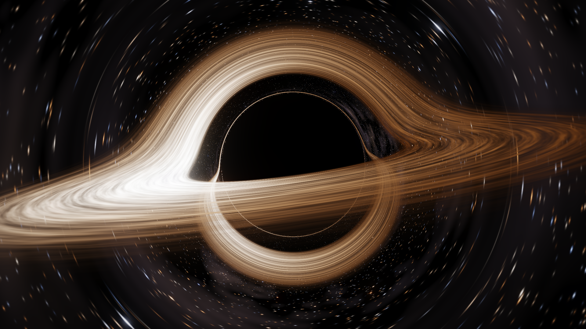
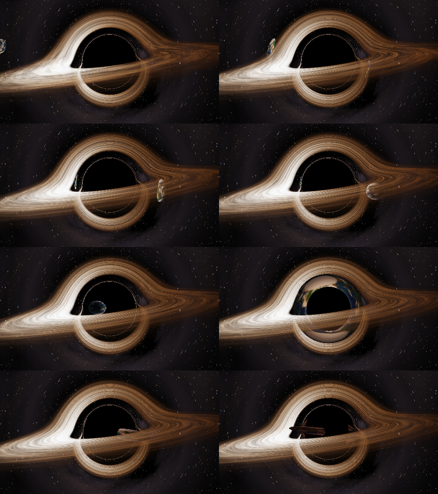
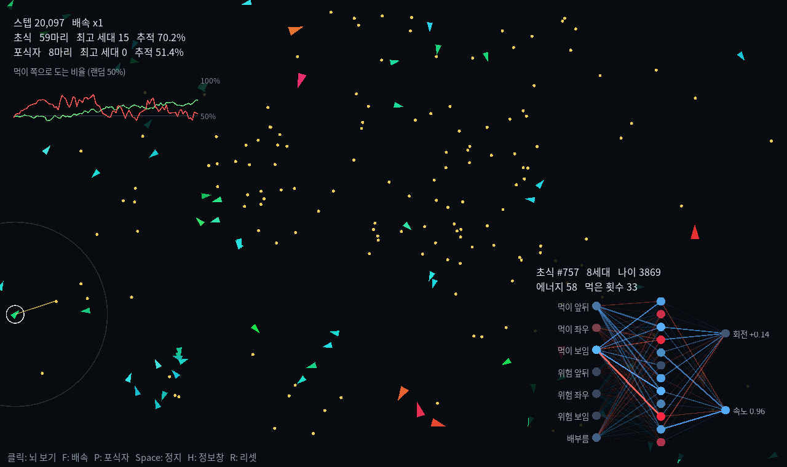

# Black Hole & Evolution

파이썬으로 만든 물리 시뮬레이션 두 가지입니다.

1. **블랙홀**: 일반상대론의 광자 궤적을 직접 적분하는 블랙홀 레이트레이서입니다. 이미지 렌더러, GPU 실시간 버전, 지구가 빨려 들어가는 버전이 있습니다.
2. **진화하는 AI 생명체**: 신경망 뇌를 가진 생명체들이 자연선택만으로 먹이 찾는 법을 스스로 깨우칩니다.



---

## 설치

```bash
python3 -m venv venv
source venv/bin/activate          # Windows: venv\Scripts\activate
pip install -r requirements.txt
```

macOS (Apple Silicon)에서 테스트했습니다.

---

## 1. 블랙홀

| 파일 | 내용 |
|---|---|
| `black_hole/black_hole_simple.py` | 간단한 2D 근사 버전입니다. matplotlib으로 그립니다. |
| `black_hole/black_hole_raytracer.py` | CPU 레이트레이서로 고화질 이미지 한 장(1920x1080)을 렌더링합니다. 약 2분 걸립니다. |
| `black_hole/black_hole_realtime.py` | GPU 셰이더로 실시간 렌더링하고, 마우스로 시점을 돌릴 수 있습니다. |
| `black_hole/black_hole_earth.py` | 실시간 버전에 블랙홀로 떨어지는 지구를 추가했습니다. |

```bash
cd black_hole
python black_hole_raytracer.py    # black_hole_hq.png 생성
python black_hole_realtime.py
python black_hole_earth.py
```

### 구현한 물리

- **슈바르츠실트 측지선**: 픽셀마다 빛을 거꾸로 쏘고, 광자 궤적 방정식 `d²x/dλ² = -1.5·h²·x/r⁵`를 RK4로 적분합니다.
- **중력렌즈**: 원반 뒤쪽이 블랙홀 위아래로 휘어 보이고, 그림자 테두리에 광자 고리가 생깁니다. 둘 다 따로 그린 게 아니라 광선 추적에서 저절로 나옵니다.
- **상대론적 도플러 빔**: 회전하는 원반 중 관측자에게 다가오는 쪽이 더 밝고 푸르게 보입니다.
- **중력 적색편이**와 흑체 복사 색상
- **지구 버전**: 질량 입자의 상대론적 궤도, 조석력에 의한 스파게티화, 렌즈로 휘어 보이는 지구의 상



### 조작법 (실시간 버전)

| 키 | 동작 |
|---|---|
| 마우스 드래그 / 스크롤 | 시점 회전 / 줌 |
| `D` | 도플러 효과 on/off |
| `R` | 카메라 자동 회전 |
| `Space` | 일시정지 |
| `E` | (지구 버전) 지구 다시 떨어뜨리기 |
| `[` `]` | (지구 버전) 시간 느리게/빠르게. 기본 버전에서는 해상도 조절 |
| `-` `=` | (지구 버전) 해상도 조절 |

GPU를 많이 쓰니까 팬이 시끄러우면 해상도를 낮추세요.

---

## 2. 진화하는 AI 생명체

```bash
cd evolution
python evolution.py              # 전체화면 (ESC로 종료)
python evolution.py --window     # 화면을 채우는 창
python evolution.py --small      # 1280x760 창
```



생명체마다 작은 신경망 뇌가 있습니다 (입력 7개 → 은닉층 12개 → 출력 2개).

- **입력**: 가장 가까운 먹이와 위험의 상대 위치, 배부름
- **출력**: 회전, 속도

처음에는 뇌가 완전히 랜덤입니다. 먹이를 잘 먹은 개체는 번식해서 뇌가 살짝 변이된 자식을 남기고, 못 먹은 개체는 굶어 죽습니다. 역전파 학습 없이 **신경진화(neuroevolution)**만으로 행동이 발전합니다.

- 왼쪽 위 그래프는 "먹이가 보일 때 그쪽으로 도는 비율"입니다. 랜덤 뇌는 50%이고, 초식 생명체는 보통 75% 근처까지 올라갑니다.
- 생명체를 클릭하면 그 개체의 신경망이 실시간으로 보입니다. 파란 선은 양의 가중치, 빨간 선은 음의 가중치이고, 밝을수록 신호가 강합니다.
- 같은 혈통은 비슷한 색을 띱니다.

| 키 | 동작 |
|---|---|
| 클릭 | 생명체 선택, 뇌 보기 |
| `F` | 배속 (x1 / x4 / x16 / MAX) |
| `P` | 포식자 등장/퇴장 |
| `Space` | 일시정지 |
| `H` | 정보창 숨기기 |
| `R` | 리셋 |
